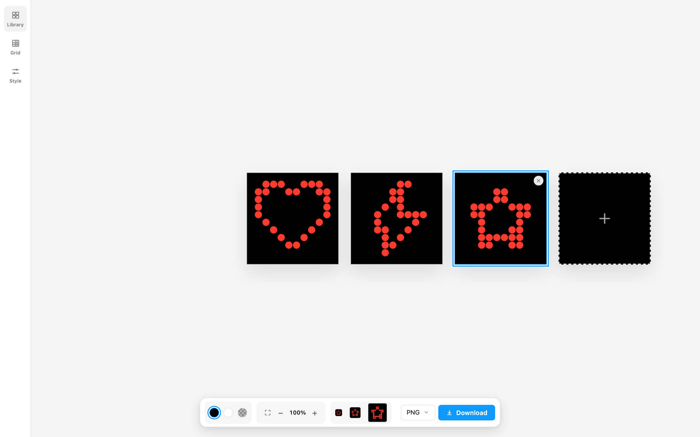

# Dot Cons

A real-time dot-matrix icon renderer that converts any icon into customisable dot grids exportable as SVG.

**Live app:** https://jondparkinson-1688.github.io/dot-cons/



## Running locally

```bash
npm install
npm run dev
```

Build for production:

```bash
npm run build
```

Pushes to `main` auto-deploy to GitHub Pages.

## Icon libraries

- [Material Symbols](https://github.com/google/material-design-icons) — Apache-2.0, © Google
- [Lucide](https://lucide.dev/) — ISC, © Lucide Contributors
- [Ionicons](https://ionic.io/ionicons) — MIT, © Ionic
- [Tabler Icons](https://tabler.io/icons) — MIT, © Tabler Icons
